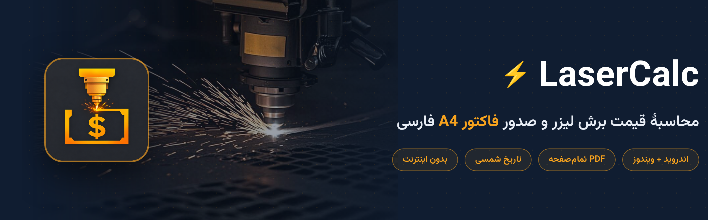
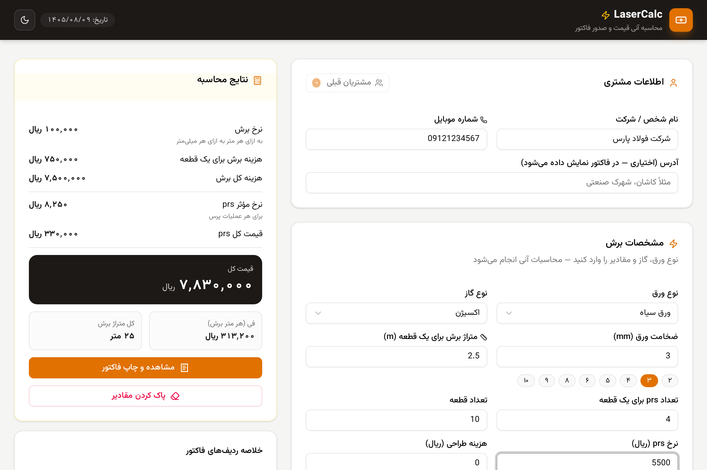
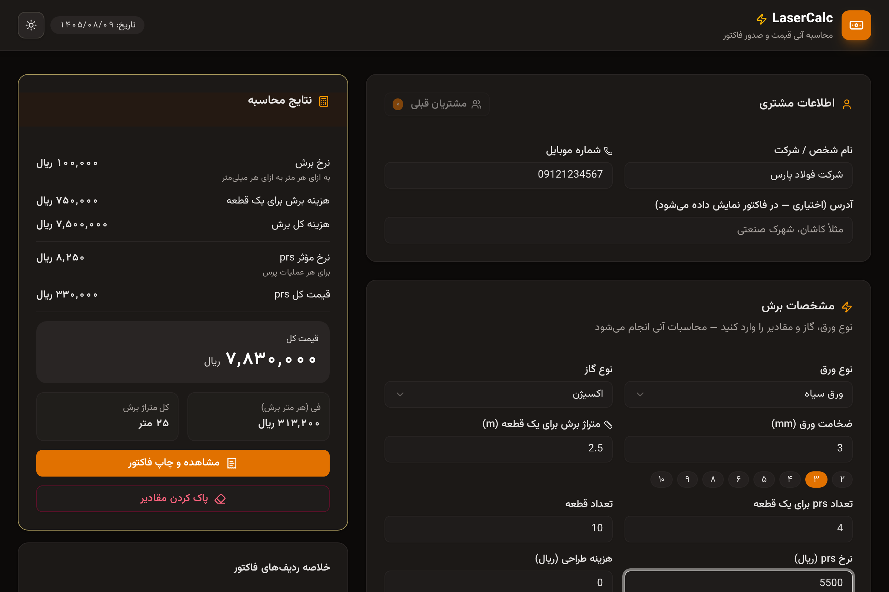
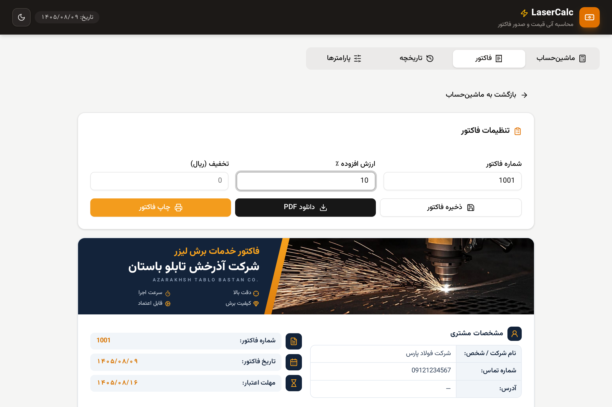
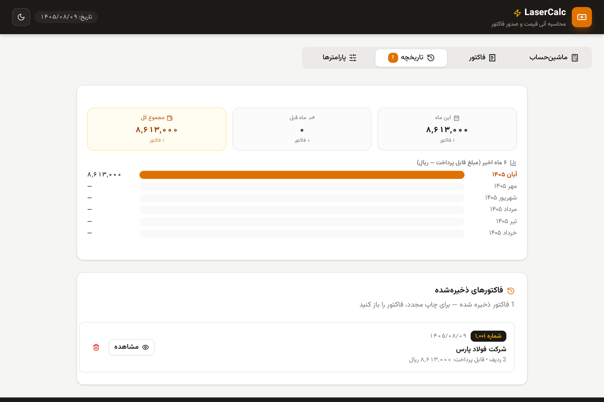
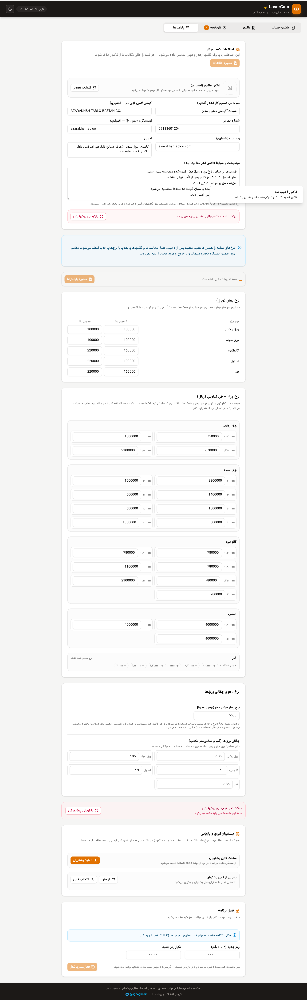
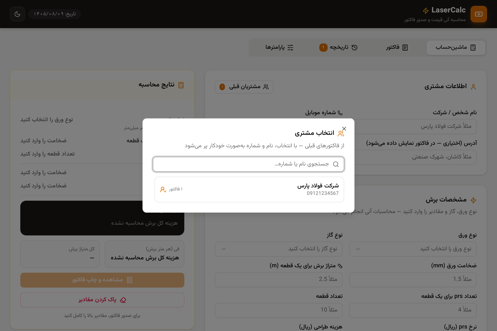
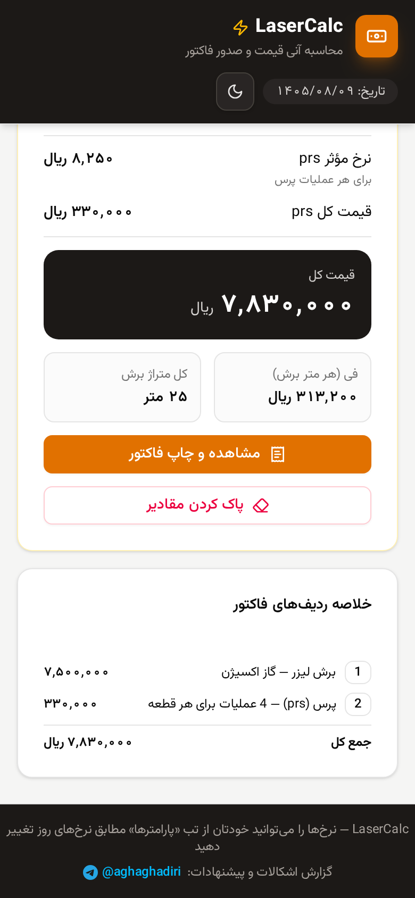
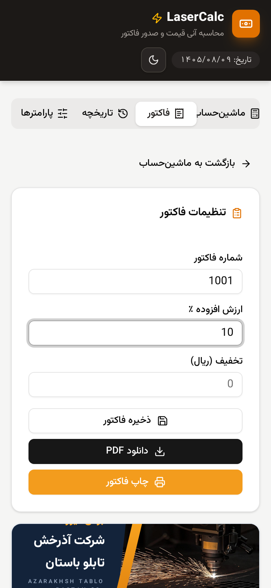
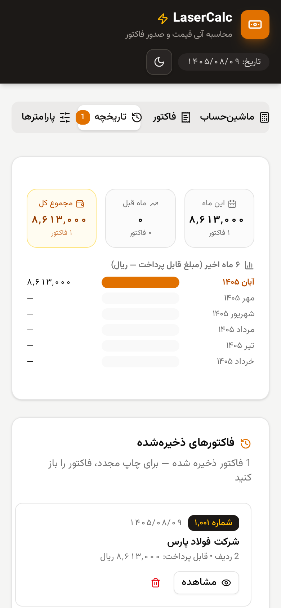

# 🔥 LaserCalc



اپلیکیشن وب برای **محاسبه آنی قیمت برش لیزر، پرس (prs) و فروش ورق** به همراه صدور فاکتور فارسی با قابلیت چاپ — کاملاً آفلاین، با نرخ‌ها و فرمول‌های قابل ویرایش.

> 🌐 **نسخهٔ وب (بدون نصب، مستقیم در مرورگر):** https://mohammadhasan80.github.io/LaserCalc/

## 📸 نمای برنامه

| | |
|---|---|
| **🧮 ماشین‌حساب لحظه‌ای** | **🌙 حالت تاریک** |
|  |  |
| **🧾 فاکتور فارسی** | **🗂️ تاریخچه و گزارش فروش** |
|  |  |
| **⚙️ پارامترها و تنظیمات کسب‌وکار** | **👥 دفترچه مشتریان** |
|  |  |

### 📱 نسخهٔ موبایل

<p align="center">
  
  
  
</p>

## ✨ امکانات

- 🧮 **ماشین‌حساب لحظه‌ای** — با تغییر هر ورودی، نتایج بلافاصله به‌روز می‌شوند
- 📋 **انتخاب نوع ورق** — روغنی، سیاه، گالوانیزه، استیل و فنر
- ⚡ **انتخاب نوع گاز** — اکسیژن یا نیتروژن (نرخ هر ترکیب متفاوت است)
- 🔢 **دکمه‌های سریع ضخامت** — ضخامت‌های ثبت‌شده هر ورق با یک کلیک
- 🏷️ **نرخ دستی ورق (فی کیلویی)** — اگر نرخ در جدول نباشد یا قیمت روز متفاوت است، همان‌جا وارد کنید
- 📐 **محاسبه وزن ورق** — بر اساس ابعاد (cm) و چگالی هر نوع ورق
- 🧾 **صدور فاکتور** — با تاریخ شمسی، شماره‌گذاری خودکار و «جمع کل به حروف»
- 📅 **تاریخ فاکتور قابل تغییر** — پیش‌فرض همان روز؛ برای فاکتورهای عقب‌تر، تاریخ شمسی (سال/ماه/روز) قابل انتخاب است
- ✍️ **امضای فروشنده** — آپلود تصویر امضا در پارامترها؛ در کادر «مهر و امضای فروشنده» پایین فاکتور (پیش‌نمایش، PDF و چاپ) درج می‌شود
- 🧭 **فوتر مرتب فاکتور** — آیکون تلفن/اینستاگرام/سایت سمت چپ متنش و آیکون آدرس سمت راست (مطابق سلیقهٔ چاپ فارسی)
- 📄 **دانلود PDF فاکتور** — بدون نیاز به چاپگر؛ در اندروید مستقیم در پوشهٔ Downloads ذخیره می‌شود؛ نام فایل: «نام شخص یا شرکت - ورق [نوع] ([ضخامت]mm) - 1405.08.11» — تاریخ در نام فایل با ارقام لاتین تا در تلگرام و فایل‌منیجرها (هر جهت پاراگرافی) مرتب و بدون به‌هم‌ریختگی نمایش داده شود؛ تاریخ داخل خود فاکتور فارسی است
- 🖨️ **چاپ بهینه** — فاکتور با استایل اختصاصی بدون منوها و دکمه‌ها
- 📐 **اندازه و جهت کاغذ** — انتخاب A4/A5 و عمودی/افقی؛ پیش‌نمایش، PDF و چاپ دقیقاً هم‌اندازه
- 💾 **تاریخچه فاکتورها** — ذخیره، بازکردن مجدد و چاپ دوباره
- 🔐 **قفل برنامه با رمز** — رمز ۴ تا ۶ رقمی با هش SHA-256 + **ورود با اثر انگشت** (اندروید ۷ به بالا، اگر دستگاه سنسور داشته باشد) با کلید روشن/خاموش + گزینهٔ «پرسیدن دوبارهٔ رمز فقط بعد از N دقیقه بی‌کاری»
- 📱 **کاملاً ریسپانسیو** — مناسب موبایل، تبلت و دسکتاپ
- 🔤 **فونت وزیرمتن** — به‌صورت محلی در `public/fonts` (بدون نیاز به اینترنت)

## 🧮 فرمول‌های محاسبه

| محاسبه | فرمول |
|--------|-------|
| نرخ برش | بر اساس ترکیب «نوع ورق - نوع گاز» |
| هزینه برش یک قطعه | متراژ برش (m) × نرخ برش × ضخامت (mm) |
| هزینه کل برش | هزینه یک قطعه × تعداد قطعه |
| نرخ مؤثر prs | ضخامت ≤ 2mm ← نرخ عادی، وگرنه (ضخامت ÷ ۲) × نرخ |
| قیمت کل prs | نرخ مؤثر × تعداد prs هر قطعه × تعداد قطعه |
| وزن ورق (kg) | مجموع (طول × عرض cm) × ضخامت × چگالی ÷ ۱۰٬۰۰۰ |
| قیمت ورق | وزن × نرخ کیلویی (اگر ورق از مشتری نباشد) |
| قیمت کل | برش + prs + طراحی + ورق |
| فی (هر متر) | قیمت کل ÷ (تعداد قطعه × متراژ) |

**چگالی ورق‌ها:** روغنی و سیاه `۷.۸۵` — استیل `۷.۹` — گالوانیزه `۷.۱` — فنر `۷.۸۵`

## 🚀 راه‌اندازی

پیش‌نیاز: [Node.js 18+](https://nodejs.org) یا [Bun](https://bun.sh)

```bash
# نصب وابستگی‌ها
npm install
# یا
bun install

# اجرای محیط توسعه
npm run dev
# یا
bun run dev
```

سپس در مرورگر باز کنید: `http://localhost:3000`

## 📁 ساختار پروژه

```
├── src/
│   ├── app/
│   │   ├── page.tsx              # صفحه اصلی (۴ تب)
│   │   ├── layout.tsx            # چیدمان RTL فارسی
│   │   └── globals.css           # فونت‌ها + استایل چاپ
│   ├── components/app/
│   │   ├── calculator.tsx        # فرم محاسبه + پنل نتایج
│   │   ├── invoice.tsx           # فاکتور A4 با چاپ
│   │   ├── history.tsx           # تاریخچه فاکتورها
│   │   ├── sales-report.tsx      # گزارش فروش ۶ ماه اخیر
│   │   ├── rates.tsx             # تب پارامترها — ویرایش نرخ‌ها
│   │   ├── business.tsx          # کارت اطلاعات کسب‌وکار (فاکتور)
│   │   ├── backup-card.tsx       # پشتیبان‌گیری و بازیابی
│   │   ├── lock-card.tsx         # تنظیم قفل برنامه
│   │   ├── lock-screen.tsx       # صفحهٔ ورود با رمز
│   │   └── customer-picker.tsx   # دفترچه مشتریان
│   ├── lib/
│   │   ├── pricing.ts            # ⚙️ موتور محاسبات و نرخ‌های پیش‌فرض
│   │   ├── persian.ts            # اعداد فارسی، عدد به حروف، تاریخ شمسی
│   │   ├── invoice-store.ts      # ذخیره‌سازی فاکتورها (localStorage)
│   │   ├── rates-store.ts        # ذخیره‌سازی پارامترهای کاربر (localStorage)
│   │   ├── business-store.ts     # ذخیره‌سازی اطلاعات کسب‌وکار (localStorage)
│   │   ├── backup.ts             # ساخت/اعتبارسنجی/بازیابی فایل پشتیبان
│   │   ├── lock.ts               # قفل برنامه با رمز (SHA-256)
│   │   └── customers.ts          # استخراج مشتری‌ها از فاکتورها
│   └── components/ui/            # کامپوننت‌های shadcn/ui
├── public/fonts/                 # فونت وزیرمتن (woff2)
└── prisma/                       # اسکیمای دیتابیس
```

## ⚙️ نرخ‌ها و پارامترها

از نسخه ۱.۱۱.۰ به بعد، کاربر می‌تواند همهٔ نرخ‌ها را خودش از تب **«پارامترها»** در برنامه تغییر دهد — بدون نیاز به نسخهٔ جدید:

- **نرخ برش** هر ترکیب ورق و گاز (مثلاً ورق سیاه با اکسیژن) — ریال به ازای هر متر به ازای هر میلی‌متر ضخامت
- **نرخ ورق (فی کیلویی)** برای هر نوع و ضخامت — و حتی افزودن ضخامت جدید (مثلاً ورق فنر ۱ میلی‌متر)
- **نرخ پیش‌فرض prs (پرس)**
- **چگالی ورق‌ها** برای محاسبهٔ وزن

نرخ‌های ذخیره‌شده روی همان دستگاه می‌ماند، در همهٔ محاسبات و فاکتورها اعمال می‌شود و با دکمهٔ «بازگردانی پیش‌فرض» می‌توان به مقادیر اولیه برگشت.

از نسخه ۱.۱۲.۰ به بعد، **اطلاعات کسب‌وکار** هم از همان تب قابل ویرایش است: نام کسب‌وکار، کپشن لاتین، شماره تماس، اینستاگرام، وبسایت، آدرس و توضیحات/شرایط فاکتور. هر فیلد را خالی بگذارید تا از فاکتور حذف شود. (ذخیره در `localStorage` با کلید `laser-business`)

از نسخه ۱.۱۳.۰ امکانات جدید در همین تب و تب تاریخچه:

- **🖼️ لوگوی فاکتور** — تصویر دلخواه در هدر فاکتور (خودکار مربع و کوچک می‌شود)
- **💾 پشتیبان‌گیری و بازیابی** — همهٔ داده‌ها (فاکتورها، نرخ‌ها، اطلاعات کسب‌وکار، شماره فاکتور) در یک فایل JSON؛ در مرورگر دانلود و در اپ در پوشه Downloads ذخیره می‌شود
- **🔒 قفل برنامه** — رمز ۴ تا ۶ رقمی برای باز کردن برنامه (رمز به‌صورت هش SHA-256 ذخیره می‌شود؛ در پشتیبان‌گیری هم گنجانده نمی‌شود تا باعث قفل‌شدن نشود)
- **👥 دفترچه مشتریان** — در ماشین‌حساب، دکمهٔ «مشتریان قبلی» از روی فاکتورهای گذشته نام و شماره را خودکار پر می‌کند
- **📊 گزارش فروش** — در تب تاریخچه: جمع این ماه، ماه قبل، مجموع کل و نمودار ۶ ماه اخیر

برای توسعه‌دهنده‌ها: مقادیر پیش‌فرض در فایل [`src/lib/pricing.ts`](src/lib/pricing.ts) قرار دارد (`CUTTING_RATES`, `SHEET_PRICES`, `DENSITY`, `DEFAULT_PRS_RATE`) و پارامترهای کاربر در `localStorage` با کلید `laser-rates` ذخیره می‌شود.

> 💡 در فرم ماشین‌حساب همیشه می‌توانید **نرخ دستی ورق (فی کیلویی)** وارد کنید؛ نرخ دستی بر نرخ جدول پارامترها اولویت دارد.

## 💾 ذخیره‌سازی داده‌ها

اطلاعات در **localStorage مرورگر** ذخیره می‌شود؛ به سرور یا دیتابیس نیازی نیست.
فاکتورها و ورودی‌ها پس از بستن مرورگر هم باقی می‌مانند.

> ⚠️ توجه: با پاک کردن حافظه مرورگر (Clear site data) فاکتورهای ذخیره‌شده حذف می‌شوند.

## 🛠️ تکنولوژی‌ها

[Next.js 16](https://nextjs.org) · [React 19](https://react.dev) · [TypeScript](https://typescriptlang.org) · [Tailwind CSS 4](https://tailwindcss.com) · [shadcn/ui](https://ui.shadcn.com) · فونت [وزیرمتن](https://github.com/rastikerdar/vazirmatn)

## 📥 دانلود

آخرین نسخه از بخش [Releases](../../releases) قابل دریافت است:

- 🌐 **نسخهٔ وب** — بدون نصب، مستقیم در مرورگر: [mohammadhasan80.github.io/LaserCalc](https://mohammadhasan80.github.io/LaserCalc/)
- 🤖 **اندروید (APK)** — `LaserCalc-v1.1.19.apk` — نصب مستقیم، کاملاً آفلاین، ذخیره PDF فاکتور در Downloads (از ۱٫۱٫۱۸: زوم غیرفعال، فاکتور رنگی/سیاه‌وسفید؛ از ۱٫۱٫۱۹: فاکتور همیشه شمسی، سوئیچ شمسی/میلادی فقط انتخابگر ورود تاریخ در بخش تنظیم را عوض می‌کند — تاریخ هنگام تغییر تقویم حفظ می‌شود)
- 🪟 **ویندوز** — `LaserCalc-v1.1.19-Windows-x64.exe` — تک‌فایل پرتابل، بدون نیاز به نصب؛ فقط اجرا کنید (ویندوز ۱۰/۱۱ ۶۴بیتی) — هم‌گام با اندروید (از ۱٫۱٫۱۸: ذخیرهٔ دائمی اطلاعات بین اجراها؛ از ۱٫۱٫۱۹: فاکتور همیشه شمسی)

### 🔄 نکتهٔ ارتقا (نسخه‌های ۱٫۱٫۱۳ و ۱٫۱٫۱۴ با کلید اشتباه)

نسخه‌های **۱٫۱٫۱۳** و **۱٫۱٫۱۴** اشتباهاً با کلید قدیمی نسخهٔ ۱٫۰٫۰ امضا شده بودند و روی نسخه‌های قبلی نصب نمی‌شدند. از نسخهٔ **۱٫۱٫۱۵** برنامه دوباره با **کلید اصلی** (همان کلید از ۱٫۱٫۳ تا ۱٫۱٫۱۲) امضا می‌شود:

- ✅ ارتقا از نسخه‌های **۱٫۱٫۳ تا ۱٫۱٫۱۲** → نصب مستقیم ۱٫۱٫۱۵ روی برنامهٔ قبلی (بدون حذف، بدون از دست رفتن داده‌ها)
- ⚠️ اگر ۱٫۱٫۱۳ یا ۱٫۱٫۱۴ را نصب کرده‌اید → یک‌بار: پشتیبان‌گیری (تب پارامترها) → حذف برنامه → نصب ۱٫۱٫۱۵ → بازیابی پشتیبان

### 🔄 ارتقا از نسخه‌های ۱٫۰٫۰ تا ۱٫۱٫۲

کلید این نسخه‌ها متفاوت است (کلید ۱٫۱٫۲ از دسترس خارج شده)؛ برای ارتقا به ۱٫۱٫۱۵: پشتیبان‌گیری (تب پارامترها) → حذف برنامه → نصب → بازیابی پشتیبان.

### 🪟 نکات نسخهٔ ویندوز

- نسخهٔ ویندوز پرتابل است: فایل را دانلود و فقط اجرا کنید — بدون نصب، بدون دسترسی ادمین.
- وب‌اپ به‌صورت آفلاین داخل EXE اجرا می‌شود (WebView2 مایکروسافت — در ویندوز ۱۱ و اکثر ویندوزهای ۱۰ از پیش نصب است؛ نبودش پیام دانلود رسمی نشان داده می‌شود).
- چون فایل‌ها امضای دیجیتال فروشگاهی ندارند، اولین اجرا ممکن است هشدار SmartScreen بدهد: روی **More info → Run anyway** کلیک کنید — طبیعی است و به معنی خطرناک بودن نیست.
- از ۱٫۱٫۱۸: اطلاعات (مشتریان، تاریخچه، تنظیمات) بین اجراهای مختلف حفظ می‌شود (پورت محلی ثابت) — در نسخه‌های قبلی ویندوز با هر اجرا پاک می‌شد. ارتقا فقط با دانلود EXE جدید و اجرای آن است؛ داده‌های نسخهٔ قبلی ویندوز قابل انتقال نیستند و از قبل هم ماندگار نبودند.

### 🎨 آیکون برنامه

آیکون لانچر جدید: سر لیزر طلایی در حال برش اسکناس. در همه تراکم‌ها (mdpi تا xxxhdpi) به‌صورت PNG کلاسیک + آیکون تطبیقی اندروید ۸ به بالا (لایه پیش‌زمینه و پیش‌زمینه جدا با رعایت دایره امن) — بدون بریدگی هیچ بخشی از تصویر روی ماسک‌های دایره‌ای یا اسکورکل لانچرها. منبع: `android-src/icon-source.png` و اسکریپت بازتولید: `android-src/make-icons.py`.

### ⚠️ پیام Google Play Protect هنگام نصب — طبیعی است

چون برنامه خارج از Google Play و مستقیم از GitHub نصب می‌شود، Play Protect ممکن است پیام «App scan recommended» نشان دهد. این پیام به معنی خطرناک بودن برنامه نیست؛ فقط به این دلیل است که Play Protect این برنامه را هنوز ندیده است. کافی است:

1. روی **Scan app** بزنید — چند ثانیه اسکن می‌کند و نصب ادامه پیدا می‌کند، یا
2. **Install without scanning** را انتخاب کنید

این هشدار با بیشتر شدن تعداد نصب‌ها به‌مرور تکرار نمی‌شود. برنامه از نظر امنیتی بازبینی شده است:

- فقط مجوزهای ضروری (اینترنت؛ حافظه فقط برای اندروید ۹ و پایین‌تر جهت ذخیره PDF)
- بدون هیچ ردیاب، آنالیتیکس یا SDK تبلیغاتی — اجرای کاملاً آفلاین
- امضای رسمی (scheme v2/v3) با کلید ثابت در همه نسخه‌ها — به‌روزرسانی بدون حذف برنامه
